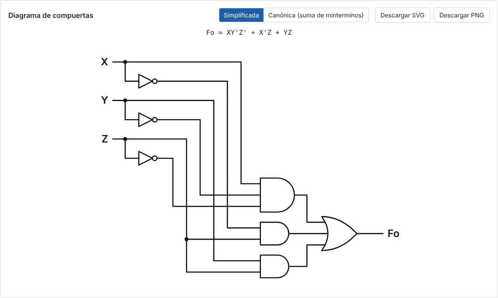

# Circuitos Booleanos

Aplicación web independiente para el **Ejercicio 9** de la NOTA P2 de *Biología Sintética 1* (UTEC):
«Álgebra booleana y construcción de circuitos genéticos (operatividad lógica)».

Un circuito lógico queda definido por tres elementos: **función booleana**, **tabla de verdad** y
**diagrama de compuertas**. Esta app obtiene los otros dos a partir de cualquiera de los dos primeros.



## Qué hace

| Modo | Entrada | Salida |
|---|---|---|
| **A · desde la fórmula** | una función como `X'Y'Z + X'YZ + XY'` | tabla de verdad, forma simplificada y diagrama |
| **B · desde la tabla** | se marcan los 1 de Fo en una tabla vacía (3 o 4 variables) | suma de minterminos, forma simplificada y diagrama |

- **Tabla de verdad**: 8 filas (X, Y, Z) o 16 si aparece W. Incluye las columnas Fo y mintérmino, y
  resalta las filas con 1. Debajo aparecen `Fo = m1 + m3 + …` y su desarrollo en variables. Con el botón
  **Copiar tabla en LaTeX** se obtiene un `tabular` con `\rowcolor`, que requiere `\usepackage[table]{xcolor}`.
- **Simplificación**: algoritmo de **Quine-McCluskey**, con el **método de Petrick** cuando no basta con los
  implicantes esenciales. Muestra los pasos para justificar el resultado en el informe: agrupamiento por
  número de unos, implicantes primos, tabla de implicantes primos con los esenciales y selección de la
  cobertura mínima. Si hay varias soluciones mínimas, las lista todas.
- **Diagrama de compuertas** en SVG, con símbolos ANSI (norteamericanos):
  - entradas a la izquierda, una columna de inversores, una AND por término producto y una OR final;
  - con un solo término no se dibuja OR, y un término de una sola variable entra directo a la OR;
  - las derivaciones llevan punto negro y los cruces sin conexión no;
  - un selector alterna entre la forma **simplificada** y la **canónica** (suma de minterminos, en orden m0, m1, …);
  - el diagrama se puede descargar como **SVG** o **PNG** (a 3× para impresión).

### Notación aceptada

| Operación | Escritura | Ejemplo |
|---|---|---|
| Negación | apóstrofe después de la variable o del paréntesis | `X'`, `(X+Y)'` |
| OR | `+` | `X + Y` |
| AND | punto o yuxtaposición | `X.Y` ≡ `XY` |
| Agrupación | paréntesis | `X(X'+Y)`, `YZ(X+X')` |

Las variables son `X`, `Y`, `Z` y, de forma opcional, `W` (W es el bit más significativo: m = 8W + 4X + 2Y + Z).
Se aceptan espacios en cualquier lugar, así como el apóstrofe tipográfico `’` y el punto medio `·` que aparecen al
copiar desde un PDF. Si la expresión está mal escrita, el mensaje de error está en español e indica la posición:

```
Posición 4: se esperaba una variable o '(' después de '+', pero se encontró '+'.
X ++ Y
   ^
```

## Cómo usarla

Abra `index.html` con Chrome; no hace falta servidor, instalación ni conexión a internet.

1. En el **modo A**, escriba la fórmula y presione **Generar** (o Enter), o haga clic en uno de los
   14 ejemplos de la guía.
2. En el **modo B**, elija 3 o 4 variables y haga clic en las filas para alternar Fo entre 0 y 1.
3. Use el selector del diagrama para alternar entre la forma simplificada y la canónica, y descárguelo en el
   formato que necesite.

## Estructura del código

Todo está en un único archivo, `index.html`, con el CSS y el JavaScript embebidos. No tiene dependencias
externas ni usa `localStorage`.

```
index.html
├── <style>                     estilos (sobrios, aptos para capturas)
├── <script id="motor">         lógica pura, sin acceso al DOM  →  objeto Motor
│   ├── 1. Parser               tokenizar, parsear (descenso recursivo), evaluar
│   ├── 2. Tabla de verdad      tablaVerdad, tablaDesdeSalidas, textoDesarrollo, tablaLatex
│   ├── 3. Simplificación       quineMcCluskey (+ Petrick), textoSOP, entradaEsMinima
│   └── 4. Diagrama             modeloDiagrama (geometría) → svgDiagrama (SVG)
└── <script id="interfaz">      eventos, dibujo de la tabla, de los pasos y del diagrama
tests/
├── tests.js                    pruebas del motor (Node, sin dependencias)
└── resultado.txt               salida de la última ejecución
capturas/                       imagen usada en este README
```

**Gramática del parser** (de menor a mayor precedencia):

```
expresion := termino ( '+' termino )*
termino   := factor ( '.'? factor )*
factor    := primario "'"*
primario  := VARIABLE | '(' expresion ')'
```

**Diagrama.** `modeloDiagrama` calcula primero un modelo geométrico (segmentos de cable, compuertas y
puntos de unión) y luego `svgDiagrama` lo convierte en SVG. Cada literal usado tiene un riel vertical. Los
rieles se ordenan en escalera para que las líneas de entrada no crucen ninguno. En la forma simplificada se
elige el orden de las compuertas con menos cruces.

## Tests

```bash
node tests/tests.js
```

Los tests extraen el bloque `<script id="motor">` de `index.html` y lo ejecutan en Node, de modo que prueban
exactamente el mismo código que usa la página. Resultado actual: **96 pruebas correctas, 0 fallidas**
(ver `tests/resultado.txt`). Cubren:

- **Los 14 casos de la guía**: los minterminos, la forma mínima, si la entrada ya era mínima y la simulación
  del diagrama dibujado, en sus formas simplificada y canónica.
- **El parser**: la notación del curso, la precedencia y 14 casos de error, con la posición exacta.
- **La tabla de verdad**: la ida y vuelta tabla → fórmula → tabla para las 65 536 funciones de 4 variables.
- **Quine-McCluskey**:
  - con 3 variables, coincide con una búsqueda exhaustiva del mínimo en las 256 funciones;
  - con 4 variables, toda solución reproduce la tabla en las 65 536 funciones.
- **El diagrama**: el circuito se reconstruye **a partir de la geometría** (un cruce sin punto no conecta y una
  derivación con punto sí) y se simula. Se comprueba con todas las funciones de 3 variables y con
  400 funciones de 4 variables.

### Discrepancias con la tabla del enunciado

La tabla de verdad es la fuente de verdad. Estas son las diferencias que encontraron los tests:

| Caso | Enunciado | Resultado |
|---|---|---|
| 2 · `XY + X'Z + YZ(X+X')` | m3, m5, m6, m7 | **m1, m3, m6, m7** (`X'Z` cubre 001 y 011). La simplificación `XY + X'Z` sí es correcta. |
| 6 · `X'Y'Z' + XY'Z + XYZ` | sin simplificar | **`X'Y'Z' + XZ`** (m5 y m7 se combinan) |
| 7 · `X'Y'Z + X'YZ + XY'Z' + XYZ` | `X'Z + XY'Z' + XYZ` | **`X'Z + YZ + XY'Z'`** (7 literales en lugar de 8) |
| 14 · `(X'.Y) + (Z'.Y)` | `Y(X'+Z')` | **`X'Y + YZ'`**. `Y(X'+Z')` es equivalente, pero factorizada; la entrada ya era mínima como suma de productos. |

## Publicar en GitHub Pages

La app es un solo archivo estático, así que GitHub Pages la sirve sin configuración adicional.

**Opción A: desde la web, sin usar la terminal**

1. Inicie sesión en [github.com](https://github.com) y cree un repositorio nuevo, **público**, por ejemplo
   `circuitos-booleanos`.
2. En el repositorio, haga clic en **Add file → Upload files** y arrastre `index.html`, `README.md` y las
   carpetas `tests/` y `capturas/`. Luego haga clic en **Commit changes**.
3. Vaya a **Settings → Pages**. En *Build and deployment*, elija *Source: Deploy from a branch*,
   *Branch: `main`* y la carpeta */ (root)*, y haga clic en **Save**.
4. Espere uno o dos minutos y recargue la página. Aparecerá el enlace:
   `https://<su-usuario>.github.io/circuitos-booleanos/`

**Opción B: con git**

```bash
cd circuitos-booleanos
```

```bash
git add . && git commit -m "App de circuitos booleanos"
```

```bash
git branch -M main
```

```bash
git remote add origin https://github.com/<su-usuario>/circuitos-booleanos.git
```

```bash
git push -u origin main
```

Luego active Pages como en el paso 3 de la opción A.

Para comprobar que funciona, abra el enlace en una ventana de incógnito y haga clic en un ejemplo. Cada vez que
suba una nueva versión de `index.html`, el sitio se actualiza solo en uno o dos minutos.

> En una cuenta gratuita, GitHub Pages solo publica repositorios públicos. Para publicar desde un repositorio
> privado se necesita GitHub Pro, que se obtiene gratis con GitHub Education para estudiantes. Aun así, el sitio
> publicado es visible para cualquiera que tenga el enlace.
